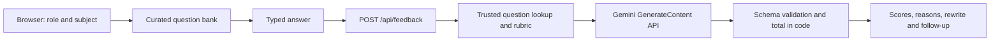

# SCSE4041 — Milestone 2 documentation

**Project:** InterviewMate AI — a prompt-engineered mock interview and feedback tool  
**Team:** Paragon · PE-B13-41 · batch B13-B24  
**Student:** Aditi Sharma · S24CSEU1175  
**Faculty:** Indrajeet Gupta  
**Submission date:** 22 November 2026

**Public prototype:** https://interviewmate-ai-7vmf.onrender.com/  
**Repository:** https://github.com/Aditish-0202/InterViewMate  
**Demonstration reel:** https://drive.google.com/file/d/1N3uFiFGp7Ce7oR-VRqsDQ9_uI2Ux7h12/view?usp=sharing

The Milestone 2 PDF is uploaded separately to the official submission form. It includes the required seven sections, four diagrams, complete final prompt sheet, four prompt versions, 12 test records, two real-run screenshots, repository screenshot, synopsis and 100% single-member contribution.

The separate one-page supporting document is **Paragon_Synopsis.pdf**; its complete text is also in Section 6 of the Milestone 2 PDF. The demonstration reel link is included above. Enter the video’s actual duration in seconds in Q14; ensure Drive sharing permits the evaluator to view it without requesting access.

## Architecture

See `prompts/` for saved versions and `test-data/` for recorded tests. No API key is stored in this repository.
